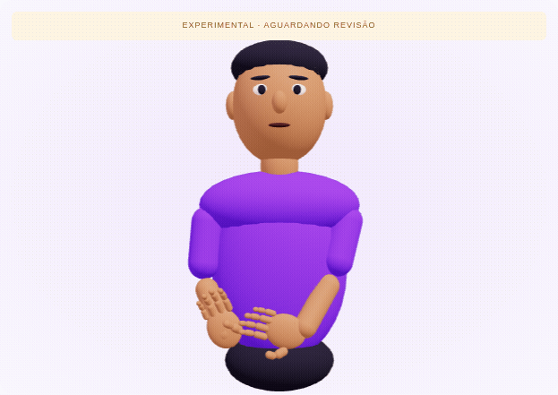

# Oi: estudo experimental de animação

Este é um rascunho técnico para revisão, não um sinal aprovado nem um material de ensino de Libras.



## Referência observada

Vídeo fornecido pelo usuário, com identificação LibrasLab, correspondente à referência informada: https://www.youtube.com/watch?v=HYuNejbG8eo . O vídeo mostra uma execução e depois uma repetição em velocidade reduzida. Foram observados o quadro completo e detalhes da mão na repetição, aproximadamente entre 8 e 15 segundos. O arquivo original não é incluído no repositório nem reproduzido no aplicativo.

A observação orientou uma sequência manual: preparação da mão dominante na região frontal do tronco, configuração curvada inicial, extensão do mínimo, sustentação e retorno ao repouso; a mão não dominante permanece próxima ao abdômen. Essa descrição é uma observação visual, não uma análise linguística certificada. A animação é estilizada e não reproduz a identidade visual da pessoa do vídeo.

## Como abrir

Execute o projeto conforme README. Na aba **Intérprete**, abaixo dos cartões principais, localize **Oi · animação para revisão** e clique **Abrir estudo experimental de Oi**. A reprodução não inicia automaticamente. Use reproduzir/pausar, voltar ao início, posição, velocidade e o controle para girar o avatar. A marca experimental permanece visível. O estudo fecha ao sair dessa aba.

O ativo está em `public/animations/oi-experimental.glb`; clipe `oi-study-v1`, duração 5,2 segundos. O manifesto adjacente registra referência, limitações e `review: null`. O GLB é autocontido, usa uma hierarquia de articulações, com três segmentos por dedo (dois para o polegar), posicionamento dos braços por cinemática inversa e trilhas de posição, rotação e escala. Não depende de serviços de IA ou captura externos.

Para editar os keyframes e regenerar os ativos:

```sh
npm run animation:oi
npm run build
```

A geração usa Three.js já instalado e funciona no Node, sem Blender. O script `scripts/create-oi-study.mjs` é a fonte editável; o GLB e o manifesto gerados são versionados. A prévia GIF é uma captura do reprodutor, não do vídeo original. Se os keyframes mudarem, a prévia precisa ser atualizada.

## Limitações e revisão pendente

- Profundidade, oposição do polegar e contato das pontas dos dedos são aproximações de uma única câmera. Não há reconstrução 3D ou captura automática.
- Proporções, orientação do punho, configurações intermediárias e temporização precisam de avaliação e ajuste. Articulações simplificadas podem causar contato ou afastamento incorretos.
- Expressão facial e movimento labial são simplificados; não há garantia de preservação de todos os componentes não manuais.
- A prévia demonstra que o arquivo anima, não que a sinalização seja compreensível ou correta.
- Ainda não houve validação por pessoa surda ou especialista, nem aprovação dos autores da referência.

O estudo **não** é inserido no catálogo de traduções. Consultar “Oi” continua retornando `unavailable`. Qualquer promoção para conteúdo de tradução exige o protocolo de `REVISAO_LIBRAS.md`, incluindo validação do arquivo final, fonte e licença apropriadas, responsáveis e versão. Não basta trocar a marca experimental por validado.
